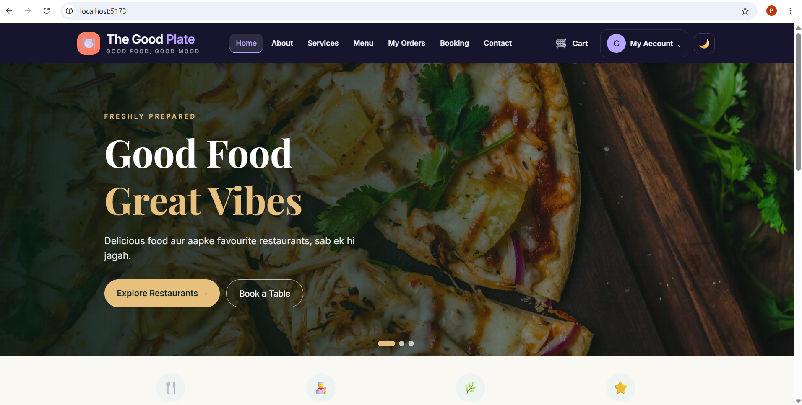
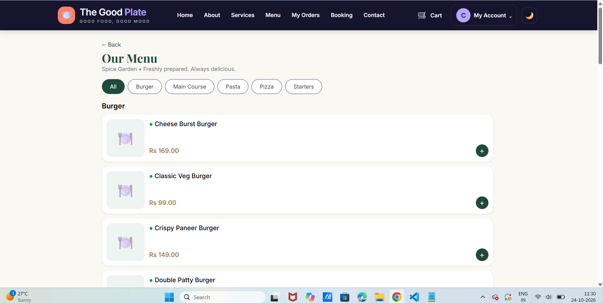
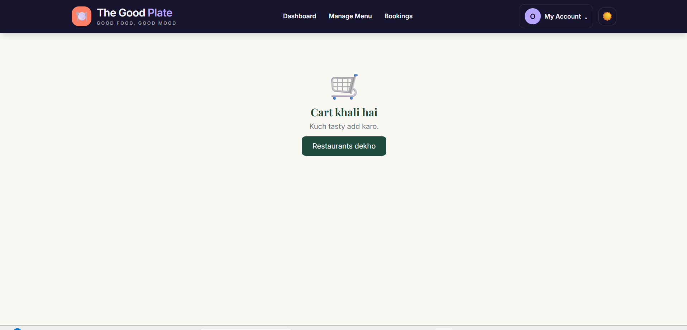
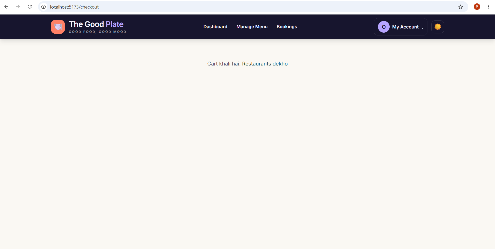
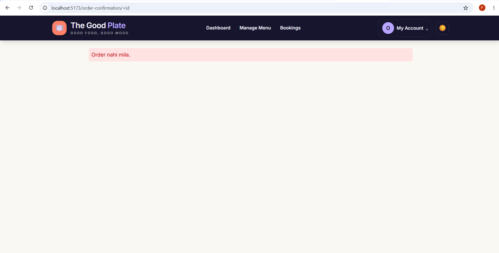
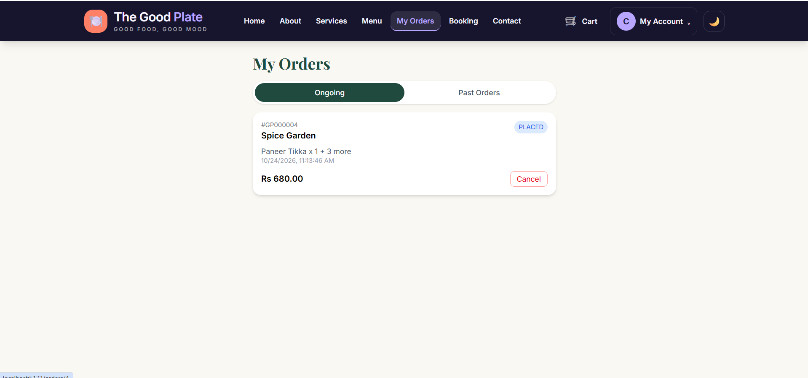
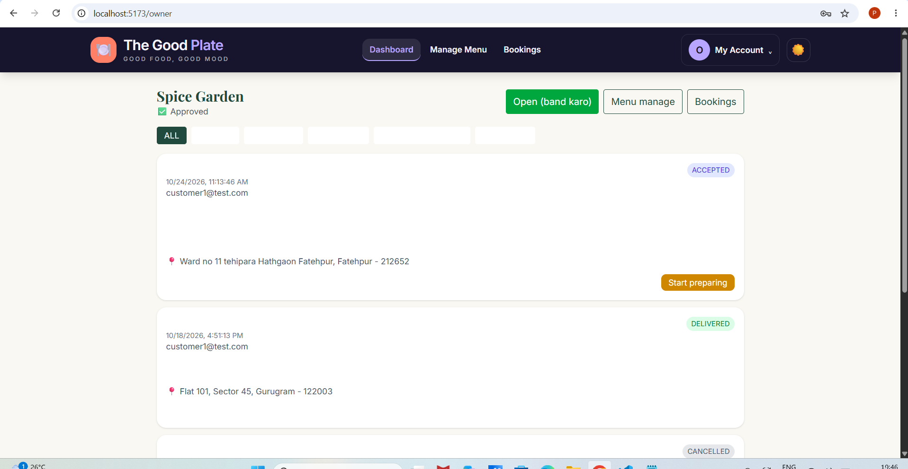
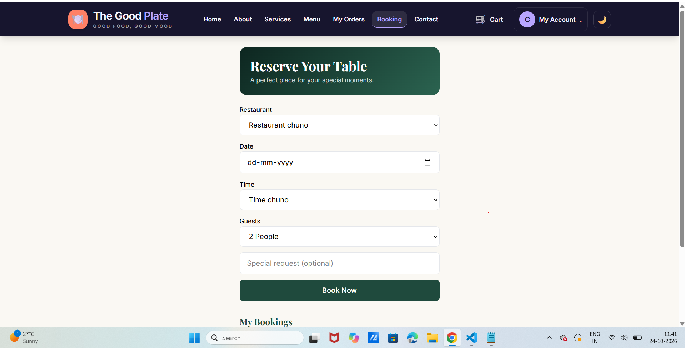
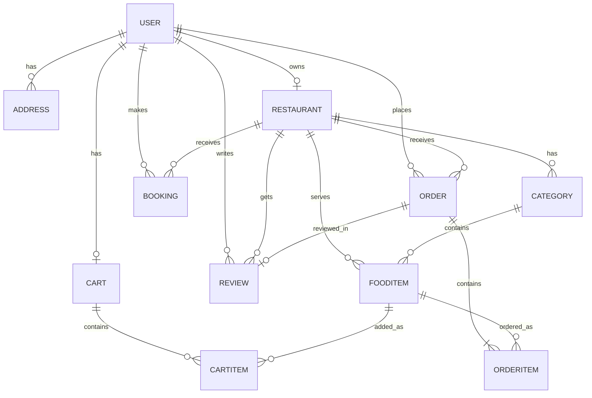

# 🍽️ The Good Plate

A full-stack, multi-restaurant food ordering platform with table booking, built with **Django REST Framework**, **React** and **PostgreSQL**.

Customers browse restaurants, order food and book tables. Restaurant owners manage their menu, orders and bookings. An admin approves restaurants and monitors the platform.

**Live demo:** _coming soon_ &nbsp;|&nbsp; **API docs:** see [API Reference](#api-reference)

---

## Screenshots

| Home | Menu | Cart |
|---|---|---|
|  |  |  |

| Checkout | Order Confirmation | My Orders |
|---|---|---|
|  |  |  |

| Owner Dashboard | Admin Dashboard | Table Booking |
|---|---|---|
|  |  |  |

---

## Features

### Customer
- Register and login with JWT authentication (auto token refresh)
- Browse approved restaurants, search by name, cuisine or city, filter by cuisine
- Restaurant menu grouped by category, veg / non-veg tags, dish detail with ingredients
- Cart with live subtotal, delivery fee and total; one restaurant per cart; minimum-order check
- Checkout with saved addresses and Cash on Delivery
- Order tracking with a status timeline (auto-refreshing)
- Cancel an order while it is still `PLACED`
- Rate and review a delivered order; restaurant rating updates automatically
- Reserve a table (date, time slot, guests)
- Profile editing and saved-address management

### Restaurant owner
- Create a restaurant (goes live after admin approval)
- Open / close the restaurant
- Incoming orders with auto-refresh and one-click status flow:
  `PLACED → ACCEPTED → PREPARING → OUT_FOR_DELIVERY → DELIVERED` (or `REJECTED`)
- Menu management: categories, dishes, availability toggle
- Confirm or reject table bookings

### Admin
- Platform stats: users, restaurants, orders, delivered revenue
- Approve / unapprove restaurants
- Latest orders overview
- Django admin for full data access

---

## Tech Stack

| Layer | Technology |
|---|---|
| Backend | Python 3.13, Django 6, Django REST Framework |
| Auth | JWT (SimpleJWT), custom email-based User model with roles |
| Database | PostgreSQL |
| Frontend | React (Vite), React Router, Axios, Tailwind CSS |
| Tooling | Git, django-cors-headers, python-dotenv |

---

## Engineering Highlights

- **Server-side totals.** Order totals are recomputed on the server from the cart; the client's amount is never trusted.
- **Price snapshot.** `OrderItem` stores the dish name and price at order time, so later menu edits never change old bills.
- **Address snapshot.** The delivery address is copied into the order.
- **State machine for orders.** The server only allows valid transitions (e.g. `PLACED → DELIVERED` is rejected).
- **Role-based permissions.** Customers, owners and admins each get their own permission classes; owners can only touch their own restaurant's data.
- **Atomic order placement.** Cart → order conversion runs in a database transaction.
- **Review integrity.** Only the customer of a `DELIVERED` order can review it, once.
- **Secrets in `.env`.** Never committed to Git.

---

## Project Structure

```
foodie-app/
├── backend/
│   ├── config/              # settings, root urls
│   └── apps/
│       ├── users/           # custom User, auth, addresses
│       ├── restaurants/     # restaurant model, approval, search
│       ├── menu/            # categories, food items, popular, dish detail
│       ├── cart/            # cart and cart items
│       ├── orders/          # orders, status flow
│       ├── bookings/        # table reservations
│       ├── reviews/         # ratings and reviews
│       └── adminpanel/      # admin stats and approvals
├── frontend/
│   └── src/
│       ├── api/             # axios instance with token refresh
│       ├── context/         # Auth and Cart state
│       ├── components/      # Navbar, BottomNav, PopularDishes, reviews
│       └── pages/           # customer, owner/ and admin/ pages
└── docs/                    # ER diagram, screenshots
```

---

## ER Diagram



---

## Getting Started

### Prerequisites
- Python 3.12+
- Node.js 20+
- PostgreSQL 15+

### 1. Clone

```bash
git clone https://github.com/<your-username>/foodie-app.git
cd foodie-app
```

### 2. Database

```sql
CREATE DATABASE foodie_db;
```

### 3. Backend

```bash
cd backend
python -m venv venv
venv\Scripts\activate          # Windows
# source venv/bin/activate     # macOS / Linux
pip install -r requirements.txt
```

Copy `.env.example` to `.env` and fill in your values:

```
SECRET_KEY=change-me
DEBUG=True
DB_NAME=foodie_db
DB_USER=postgres
DB_PASSWORD=your-password
DB_HOST=localhost
DB_PORT=5432
```

```bash
python manage.py migrate
python manage.py createsuperuser
python manage.py runserver
```

Backend runs at `http://127.0.0.1:8000`.

### 4. Frontend

```bash
cd frontend
npm install
npm run dev
```

Frontend runs at `http://localhost:5173`.

### 5. First-time setup

1. Register a user with the **Restaurant Owner** role and create a restaurant from the dashboard.
2. Log in as the admin and approve it (Admin Dashboard, or `/admin/`).
3. Add categories and dishes from the owner's Menu page.
4. Register a customer and place an order.

---

## API Reference

All endpoints are prefixed with `/api`. Protected endpoints need `Authorization: Bearer <access_token>`.

### Auth and profile
| Method | Endpoint | Description |
|---|---|---|
| POST | `/auth/register/` | Create an account (customer, owner or delivery) |
| POST | `/auth/login/` | Get access and refresh tokens |
| POST | `/auth/token/refresh/` | Refresh the access token |
| GET / PATCH | `/auth/me/` | View / update own profile |
| GET, POST | `/addresses/` | List / add saved addresses |
| PATCH, DELETE | `/addresses/<id>/` | Update / delete an address |

### Restaurants and menu (public)
| Method | Endpoint | Description |
|---|---|---|
| GET | `/restaurants/?search=&city=&cuisine=` | Approved restaurants |
| GET | `/restaurants/<id>/menu/` | Menu grouped by category, with rating |
| GET | `/menu/popular/` | Most-ordered available dishes |
| GET | `/menu/dishes/<id>/` | Dish detail with ingredients |

### Restaurant owner
| Method | Endpoint | Description |
|---|---|---|
| POST | `/restaurants/` | Create own restaurant |
| GET | `/restaurants/mine/` | Own restaurant |
| PATCH | `/restaurants/<id>/` | Edit / open / close |
| GET, POST | `/menu/categories/` | Manage categories |
| GET, POST | `/menu/items/` | Manage dishes |
| PATCH, DELETE | `/menu/items/<id>/` | Edit / delete a dish |
| GET | `/orders/restaurant/?status=` | Incoming orders |
| POST | `/orders/<id>/status/` | Move an order to the next status |
| GET | `/bookings/restaurant/` | Table bookings |
| POST | `/bookings/<id>/status/` | Confirm / reject a booking |

### Customer
| Method | Endpoint | Description |
|---|---|---|
| GET | `/cart/` | Current cart with totals |
| POST | `/cart/add/` | Add a dish |
| PATCH, DELETE | `/cart/items/<id>/` | Change quantity / remove |
| DELETE | `/cart/clear/` | Empty the cart |
| POST | `/orders/place/` | Place an order from the cart |
| GET | `/orders/` | Own orders |
| GET | `/orders/<id>/` | Order detail |
| POST | `/orders/<id>/cancel/` | Cancel (only while `PLACED`) |
| GET, POST | `/bookings/` | Own bookings / reserve a table |
| POST | `/bookings/<id>/cancel/` | Cancel a booking |
| GET, POST | `/reviews/` | List reviews (`?restaurant=`, `?order=`) / review a delivered order |

### Admin
| Method | Endpoint | Description |
|---|---|---|
| GET | `/admin-panel/stats/` | Platform statistics |
| GET | `/admin-panel/restaurants/` | All restaurants |
| POST | `/admin-panel/restaurants/<id>/approve/` | Approve / unapprove |

---

## Demo Accounts

Create these locally (see first-time setup):

| Role | Email |
|---|---|
| Customer | `customer1@test.com` |
| Restaurant owner | `owner1@test.com` |

Use a password of your choice. Never commit real credentials.

---

## Roadmap

- [ ] Online payments with Razorpay (UPI, cards, net banking)
- [ ] Coupons and discount codes
- [ ] Delivery partner assignment and live tracking
- [ ] Dish-level ratings and image upload from the owner dashboard
- [ ] Automated tests and CI
- [ ] Production deployment (Render + Vercel)

---

## License

MIT